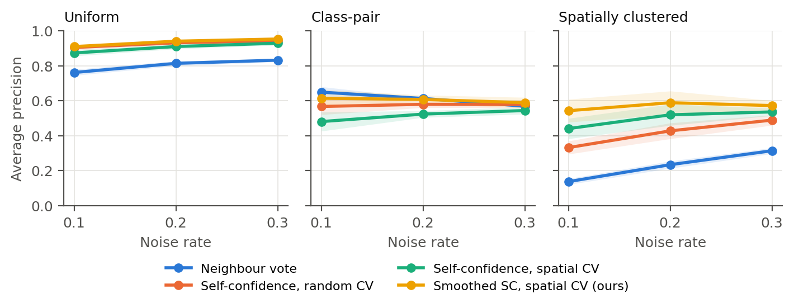

# geolabelqa

**Spatially aware quality assurance for geospatial machine-learning training labels.**

[](https://github.com/sidewalkds-oss/geolabelqa/actions/workflows/ci.yml)


Land-cover maps, building detectors and crop classifiers all depend on hand-labelled
training samples, and those labels are wrong more often than anyone would like.
Worse, the mistakes are rarely random. One annotator misreads cropland as grassland
across a whole tile, or an outdated basemap shifts every label in a district. Errors
like these come in **spatial clusters**, and that defeats the two checks most teams
rely on:

* **"Does it agree with its neighbours?"** fails because the neighbours carry the same mistake.
* **"Does a model trained on the rest disagree with it?"** fails when cross-validation is
  random: a model that sees coordinates (or spatially autocorrelated features) learns the
  mistake from nearby training points and confirms it.

`geolabelqa` packages the fix that the accompanying paper evaluates:

1. **Spatial block cross-validation** for out-of-fold class probabilities, so a sample is
   never judged by a model trained on its own neighbourhood.
2. **Spatial smoothing of those probabilities** over each sample's *k* nearest neighbours,
   which pools evidence from independent predictions instead of from shared labels.
3. **Self-confidence ranking + confident-learning flags** (Northcutt et al., 2021) on the
   smoothed probabilities.

It also ships a dependency-light **GeoJSON polygon validator** (self-intersections, slivers,
winding order, unclosed rings, holes outside shells, duplicates, missing labels) for
checking annotation geometry before you check annotation classes.

📄 **Paper:** [`paper/paper.tex`](paper/paper.tex), *Spatially Aware Label-Error Detection
for Geospatial Training Data* (a PDF is built by CI on every push).

---

## Installation

```bash
git clone https://github.com/sidewalkds-oss/geolabelqa.git
cd geolabelqa
pip install -e ".[dev]"
```

Runtime dependencies: `numpy`, `scipy`, `scikit-learn`, `pandas`. No GDAL/GEOS needed.

## Quick start

### Python

```python
from geolabelqa import LabelAuditor

# X: (n, n_features) e.g. Sentinel-2 bands/indices; coords: (n, 2) in a PROJECTED CRS
report = LabelAuditor(block_size=10_000, k=10).audit(X, labels, coords)
report.head(20)          # most suspicious samples first
report[report.cl_flag]   # confident-learning flags
```

| column | meaning |
|---|---|
| `index` | row in your input |
| `label` / `suggested_label` | given label and the model's best alternative |
| `suspicion` | 0–1; 1 − smoothed out-of-fold probability of the given label |
| `cl_flag` | flagged by the confident-learning rule |
| `neighbour_disagreement` | share of *k* nearest neighbours with a different label (shown for context) |

Set `block_size` larger than the range of spatial autocorrelation in your data (a
variogram, or the typical size of a homogeneous field/patch, is a good guide).

### Command line

```bash
geolabelqa demo -o demo.csv                     # synthetic dataset with 15% clustered errors
geolabelqa audit demo.csv --x x --y y --label label \
    --features blue,green,red,nir,swir1,swir2,ndvi,ndwi,ndbi -o report.csv
geolabelqa validate annotations.geojson --label-property class
```

`validate` exits non-zero if any error-level issue is found, so it can gate a CI pipeline
for an annotation repository.

## Results

Synthetic 50 × 50 km land-cover benchmark: 6 classes, 3,000 training points,
random-forest classifier, 5 seeds. Errors are injected as uniform, class-pair
(look-alike classes) or spatially clustered (whole patches mislabelled).
Reproduce it with `python experiments/run_benchmark.py && python experiments/make_figures.py`.

**Detecting corrupted labels**: average precision at a 20% error rate (chance = 0.20).
Features = spectral bands + x,y coordinates, a common geo-ML setup:

| Detector | Uniform | Class-pair | Clustered |
|---|---|---|---|
| Neighbour vote | 0.813 | 0.613 | 0.234 |
| Self-confidence, random CV (standard confident learning) | 0.931 | 0.579 | 0.427 |
| Self-confidence, spatial block CV | 0.910 | 0.523 | 0.519 |
| **Smoothed self-confidence, spatial block CV** (`LabelAuditor` default) | 0.940 | 0.607 | **0.588** |

Findings:

- **Neighbour voting is near chance on clustered errors.** The neighbours share the mistake.
- **Random CV + coordinates hides clustered errors.** The model learns the bad patch.
  Spatial block CV beat random CV in **15/15** clustered-noise runs. It costs 0.02–0.06 AP
  when errors are independent, so think of it as insurance.
- **Smoothing improved AP in 180/180 runs** (all regimes, rates, seeds, feature sets and CV schemes).
- Best clustered-noise result: spectral features only + spatial CV + smoothing, **AP 0.653**.
  Keep coordinates out of the auditing model.
- **Honest negative result:** removing the top-n flagged samples did *not* measurably
  improve a random forest's test macro-F1 (clustered: 0.759 → 0.763, against 0.810 for an
  oracle). Use the ranking to direct human review, not for automatic deletion.

Full tables, ablations (smoothing strength, block size) and discussion are in the paper.
Raw results are in [`results/`](results/).



## Repository layout

```
src/geolabelqa/
  auditor.py      LabelAuditor - the high-level API
  detectors.py    out-of-fold probabilities, self-confidence, CL flags, smoothing, neighbour vote
  spatial_cv.py   SpatialBlockKFold (with optional buffer)
  geometry.py     GeoJSON polygon validator
  synthetic.py    synthetic land-cover generator and noise models
  metrics.py      AUROC / AP / precision@N, flag precision/recall/F1
  cli.py          `geolabelqa` command
experiments/      benchmark + figure/table generation
results/          raw CSVs from the benchmark
paper/            LaTeX source, figures, tables
tests/            pytest suite
```

## Limitations

The benchmark is synthetic. It controls the noise process exactly, which real
data can't, but it can't stand in for real annotation campaigns. Validation on
public land-cover reference sets with documented label errors is the obvious next
step. See the paper's discussion section.

## Citation

```bibtex
@misc{omar2026geolabelqa,
  title  = {Spatially Aware Label-Error Detection for Geospatial Training Data},
  author = {Omar, Kaisi},
  year   = {2026},
  url    = {https://github.com/sidewalkds-oss/geolabelqa}
}
```

## License

MIT
